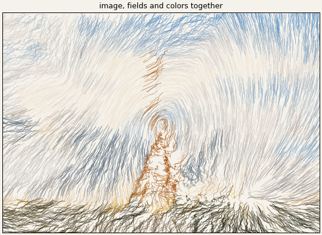
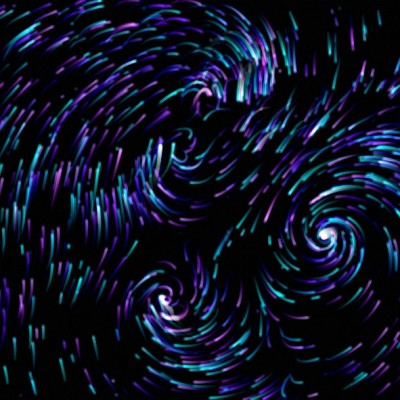
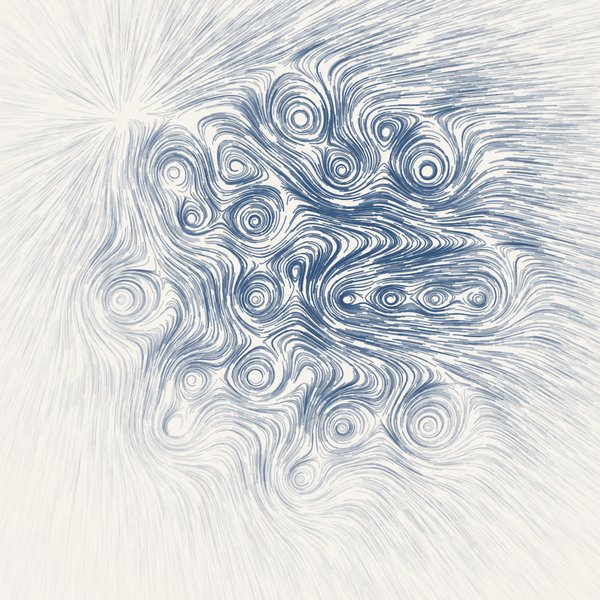
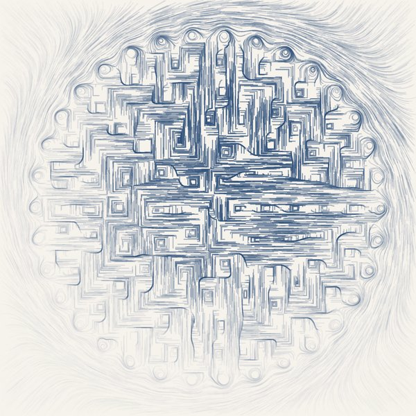
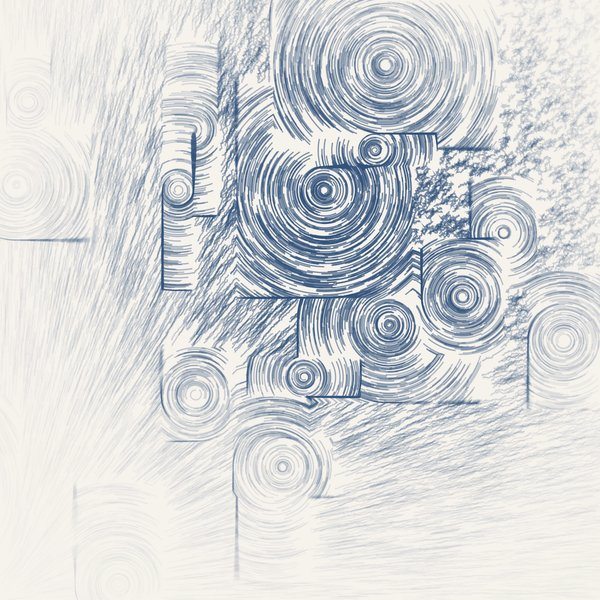
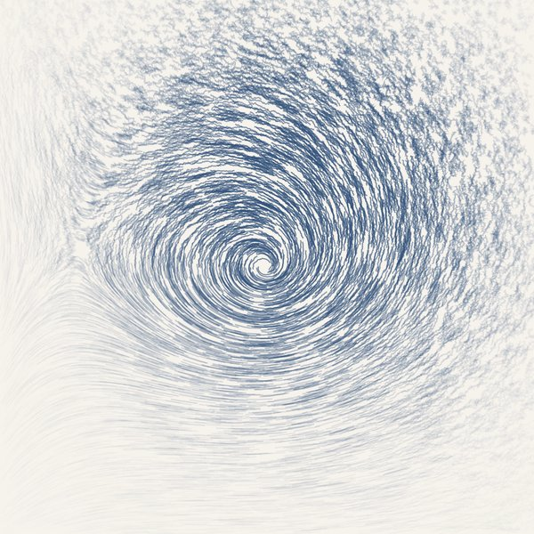
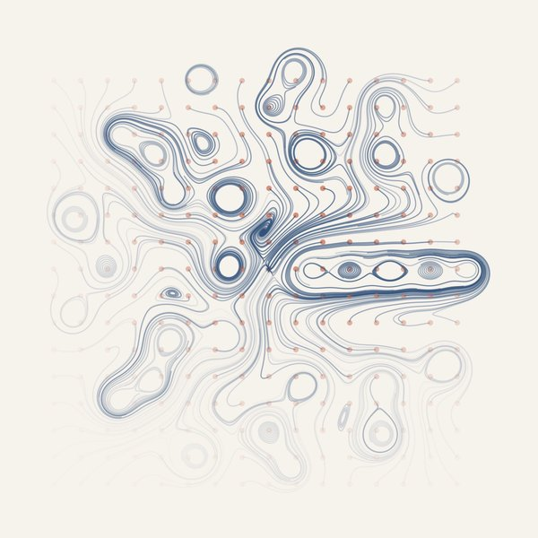
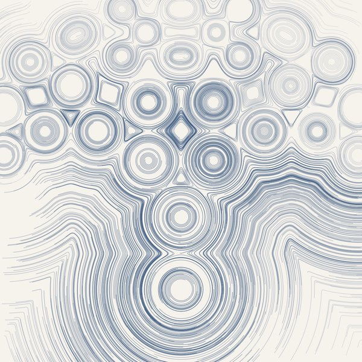

# flowfields

[](https://github.com/tiagoft/flowfields/actions/workflows/tests.yml)
[](https://github.com/tiagoft/flowfields/actions/workflows/tests.yml)



A generative-art toolkit built around composable **vector fields** and **scalar fields**.  Fields form trees (similar to syntax trees): leaf nodes are primitives and internal nodes are combinators.  It comes in Python and as a [p5.js](https://p5js.org) library.

See the [demos](https://github.com/tiagoft/flowfields/blob/main/demos/README.md) for a small script and a figure for each feature.

## Installation

### Python

```bash
pip install flowfields
# or
uv add flowfields
```

The library needs only numpy and Pillow. `MatrixField.plot_figure` also needs
matplotlib, which comes with the `plot` extra:

```bash
pip install "flowfields[plot]"
```

To get the latest version from GitHub instead:

```bash
pip install git+https://github.com/tiagoft/flowfields.git
```

### p5.js

`flowfields.js` needs p5.js 2.x. Load it after p5:

```html
<script src="https://cdn.jsdelivr.net/npm/p5@2.4.0/lib/p5.min.js"></script>
<script src="https://cdn.jsdelivr.net/gh/tiagoft/flowfields@v0.2.0/js/flowfields.js"></script>
```

Build fields inside `setup()` or later. The [JS README](https://github.com/tiagoft/flowfields/blob/main/js/README.md) shows how
the Python API maps to JS, and [`js/examples/`](https://github.com/tiagoft/flowfields/tree/main/js/examples) has drop-in sketches:
single HTML files to save and open in a browser.

### Running the demos

```bash
git clone https://github.com/tiagoft/flowfields.git
cd flowfields
uv run python demos/16-field_tree.py
```

---

## Concepts

### Scalar fields — `flowfields.scalar_fields`

A scalar field maps a 2-D point to a single float: `f(x) → float`.  They are used as spatial weights inside composite vector fields.

| Class | Equation |
| --- | --- |
| `GaussianField(center, sigma, scale)` | `f(x) = scale · exp(−‖x − center‖² / 2σ²)` |
| `ConstantField(value)` | `f(x) = value` |
| `BoxField(min_corner, max_corner, inside_value, outside_value)` | `inside_value` if `x` is inside the box, else `outside_value` |

### Vector fields — `flowfields.vector_fields`

A vector field maps a 2-D point to a 2-D vector: `F(x) → np.ndarray`.  Most fields accept `normalize=True` (default) to return a unit vector.

#### Primitive fields

| Class | Equation |
| --- | --- |
| `RotationField(center, direction)` | `v(x) = direction · [−rᵧ, rₓ]` where `r = x − center` |
| `ExpansionField(center, direction)` | `v(x) = direction · (x − center)` |
| `NoiseField(distribution)` | `v ~ Normal(0, 1)ⁿ` by default, or `v ~ Uniform(−1, 1)ⁿ` with `distribution="uniform"` (fresh sample every call) |

#### Composite fields — combine other fields into a tree

| Class | Behaviour |
| --- | --- |
| `FieldSum(fields, weights)` | `v(x) = Σᵢ wᵢ(x) · Fᵢ(x)` — weighted linear blend |
| `FieldMax(fields, weights)` | `v(x) = F_{argmax wᵢ(x)}(x)` — hard winner-take-all |
| `FieldSelect(fields, weights, ...)` | probabilistic selection; switches fields over time with optional linear interpolation |

Weights can be a plain `float`, a `ScalarField` instance (position-dependent), or `None` (equal weights).

---

## Basic usage

```python
import numpy as np
import flowfields.scalar_fields as sf
import flowfields.vector_fields as vf

field = vf.FieldSum(
    fields=[
        vf.RotationField(np.array([2.0, 0.0])),
        vf.RotationField(np.array([-5.0, 0.0]), direction=-1),
        vf.ExpansionField(np.array([2.0, -6.0])),
    ],
    weights=[
        sf.GaussianField(np.array([1.0, 0.0]), sigma=3.0),
        sf.ConstantField(0.2),
        sf.ConstantField(0.5),
    ],
)

x = np.array([1.0, 0.5])
v = field(x)   # unit vector at point x
```

### Swapping fields

Fields accept keyword arguments they do not use, so one field type can
replace another with a slightly different API. Each unused argument gives an
`UnusedArgumentWarning`, which also catches typos:

```python
vf.RotationField(center, normalise=False)
# UnusedArgumentWarning: RotationField ignores the argument 'normalise' (did you mean 'normalize'?)
```

To swap fields on purpose without the warning:

```python
import warnings
import flowfields

warnings.simplefilter("ignore", flowfields.UnusedArgumentWarning)
```

## Gallery

### Live on OpenProcessing

[](https://openprocessing.org/sketch/3068861)

[Moving Vortices Number 1](https://openprocessing.org/sketch/3068861) runs
flowfields.js in the browser: click the image to open it. Its code is
[`js/examples/vortices.html`](https://github.com/tiagoft/flowfields/blob/main/js/examples/vortices.html).

### Genuary 2026

Pieces made with flowfields for [Genuary 2026](https://genuary.art). Click an image to see its code.

| | | |
| --- | --- | --- |
| [](https://github.com/tiagoft/flowfields/blob/main/artwork/genuary2026/genuary03.py) | [](https://github.com/tiagoft/flowfields/blob/main/artwork/genuary2026/genuary08.py) | [](https://github.com/tiagoft/flowfields/blob/main/artwork/genuary2026/genuary12.py) |
| [](https://github.com/tiagoft/flowfields/blob/main/artwork/genuary2026/genuary16.py) | [](https://github.com/tiagoft/flowfields/blob/main/artwork/genuary2026/genuary19.py) | [](https://github.com/tiagoft/flowfields/blob/main/artwork/genuary2026/genuary25.py) |

All pieces are in [`artwork/genuary2026`](https://github.com/tiagoft/flowfields/tree/main/artwork/genuary2026).

## License

flowfields is free software, released under the
[GNU Affero General Public License v3.0 or later](https://github.com/tiagoft/flowfields/blob/main/LICENSE). Images and other
works you make with it are yours; programs that use or modify the library,
including sketches served on the web, must be shared under the same license.
