# Demos

One small script for each feature of `tstudio`. Each script saves its figure in [`outputs/`](outputs/) with the same name as the script, and the random seed is fixed, so running it again gives the same figure.

To run one demo, or all of them:

```bash
uv run python demos/01-gaussian_field.py
for demo in demos/[0-9]*.py; do uv run python "$demo"; done
```

[`_common.py`](_common.py) has the drawing code the demos share (`heatmap`, `arrows`, `strokes`), so each script only shows its own class. `strokes` is the main one: it starts at random points and follows the field for a few steps, drawing a line.

Demos that need an image use [`eiffel.jpeg`](eiffel.jpeg).

| Group | Demos |
| --- | --- |
| Scalar fields | [GaussianField](#01--gaussianfield), [ConstantField](#02--constantfield), [BoxField](#03--boxfield), [MatrixField](#04--matrixfield), [KernelProbabilisticMatrixField](#05--kernelprobabilisticmatrixfield) |
| Vector fields | [RotationField](#06--rotationfield), [ExpansionField](#07--expansionfield), [NoiseField](#08--noisefield) |
| Combining fields | [FieldSum](#09--fieldsum), [FieldMax](#10--fieldmax), [FieldSelect](#11--fieldselect) |
| Color fields | [MatrixColorField](#12--matrixcolorfield) |
| Vector utilities | [rotate_vector](#13--rotate_vector), [quantize_vector](#14--quantize_vector), [clamp_vector](#15--clamp_vector) |
| Everything together | [A tree of fields](#16--a-tree-of-fields) |

## Scalar fields

A scalar field gives one number for each point: `f(x) → float`. Scalar fields are mostly used as weights that change across space.

### 01 — GaussianField

[`01-gaussian_field.py`](01-gaussian_field.py)

A smooth bump: `f(x) = scale · exp(−‖x − center‖² / 2σ²)`. A larger `sigma` makes it wider.

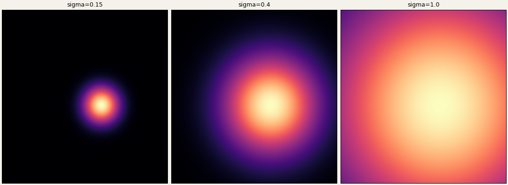

### 02 — ConstantField

[`02-constant_field.py`](02-constant_field.py)

The same value everywhere: `f(x) = value`. A plot of it would be a flat color, so this demo uses it as the weight of an expansion added to a rotation. The value sets how open the spiral is.

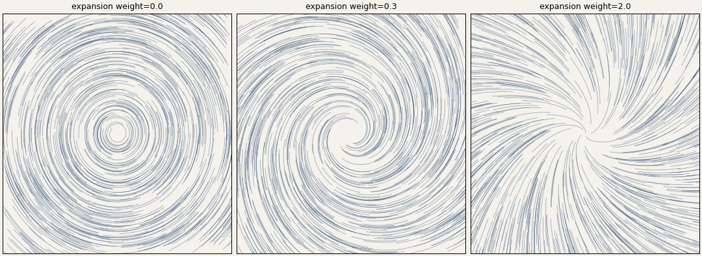

### 03 — BoxField

[`03-box_field.py`](03-box_field.py)

`inside_value` inside a rectangle and `outside_value` outside of it. As a weight, it turns a field on only inside the rectangle. Here a rotation only exists inside the box, and a weak expansion moves the lines everywhere else.

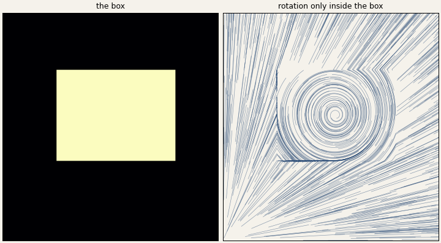

### 04 — MatrixField

[`04-matrix_field.py`](04-matrix_field.py)

Reads values from a 2D array, with bilinear interpolation, so an image can work as a weight. Here the image brightness sets the opacity of each line. The point `max_corner` matches the top right of the image, and the value is `0` outside the box.

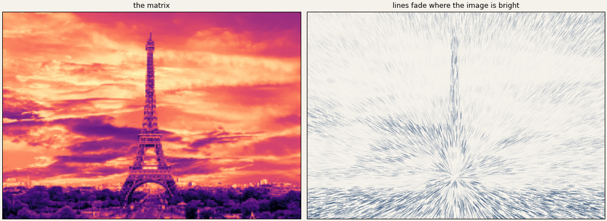

`plot_figure` saves a plot of the array:

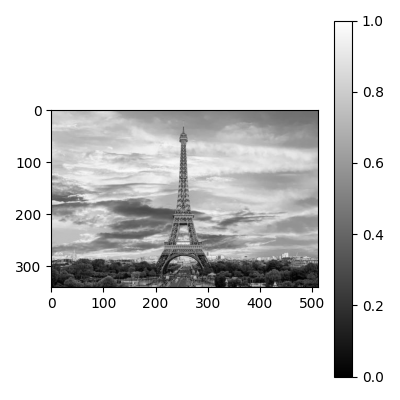

### 05 — KernelProbabilisticMatrixField

[`05-kernel_probabilistic_matrix_field.py`](05-kernel_probabilistic_matrix_field.py)

A `MatrixField` multiplied by a Gaussian centered on the bounding box, so the image fades toward the edges. `sigma` uses the same units as the coordinates.

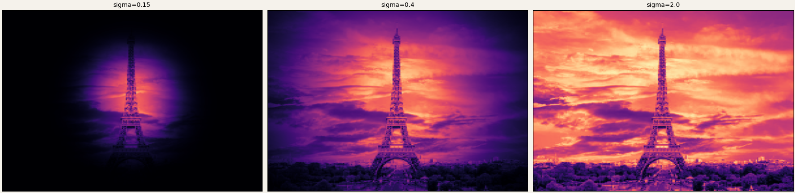

## Vector fields

A vector field gives one vector for each point: `F(x) → np.ndarray`. With `normalize=True`, the default, the vector has length 1, so only its direction matters.

The red arrows in demos 06 and 07 show the direction of the field.

### 06 — RotationField

[`06-rotation_field.py`](06-rotation_field.py)

Circles around a center: `v(x) = direction · [−r_y, r_x]`, where `r = x − center`. `direction=1` is counter-clockwise and `direction=-1` is clockwise. With `normalize=False` the vectors grow with the distance from the center, so lines near the center are shorter.

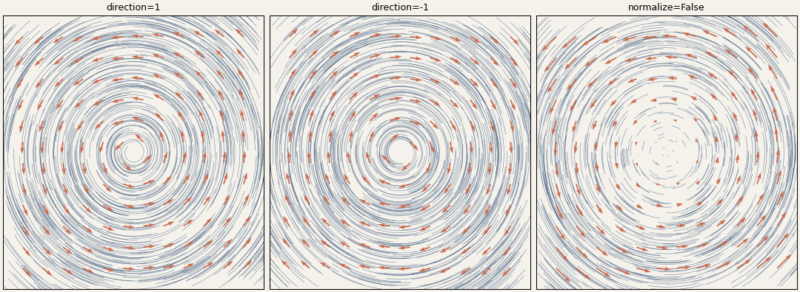

### 07 — ExpansionField

[`07-expansion_field.py`](07-expansion_field.py)

Rays from a center: `v(x) = direction · (x − center)`. `direction=1` points outward and `direction=-1` points inward, so the lines gather at the center.

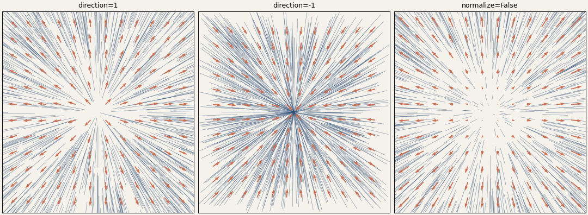

### 08 — NoiseField

[`08-noise_field.py`](08-noise_field.py)

A new random vector at every call, regardless of the position. Following it gives a random walk. Without normalization the steps also vary in length. Added to another field, it makes the lines rough.

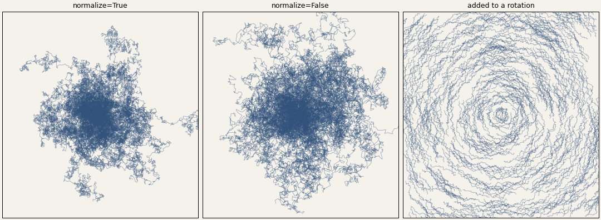

Each coordinate comes from a normal distribution by default, which makes all directions equally likely. With `distribution="uniform"` the vectors come from a square, which favors the diagonals. Each line below is one vector:

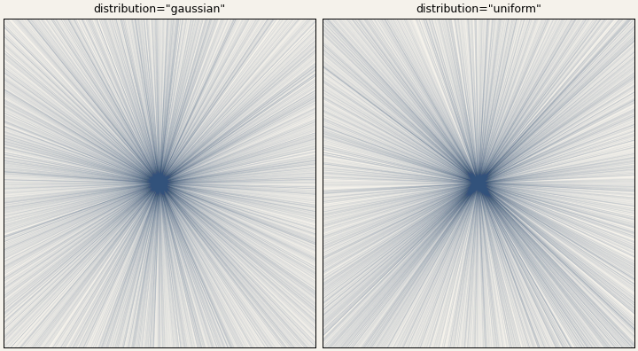

## Combining fields

These classes take other fields as input and are vector fields themselves, so they can be nested. Weights can be numbers or scalar fields, and `weights=None` makes all weights equal.

### 09 — FieldSum

[`09-field_sum.py`](09-field_sum.py)

The weighted sum of the fields: `v(x) = Σ wᵢ(x) · Fᵢ(x)`. Here two rotations in opposite directions combine in three ways. With Gaussian weights, each one dominates near its own center.

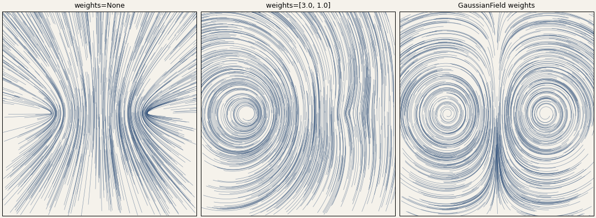

### 10 — FieldMax

[`10-field_max.py`](10-field_max.py)

Uses only the field with the highest weight at each point, which splits the plane into regions with sharp borders.

With `weights=None` all fields tie and the first one always wins, so this class is only useful with weights.

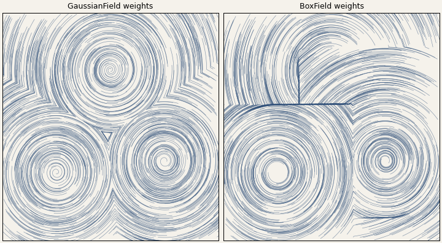

### 11 — FieldSelect

[`11-field_select.py`](11-field_select.py)

Draws which fields are active, and switches between them with probability `change_id_prob` at each call. The result depends on the previous calls as well as on the position, so this demo draws a single long line.

- `lerp_len` smooths each switch over that many calls. Compare the corners of the first panel with the curves of the second.
- `select_n` is how many fields are active at the same time.
- A higher `temperature` makes the draw closer to uniform, ignoring the weights.

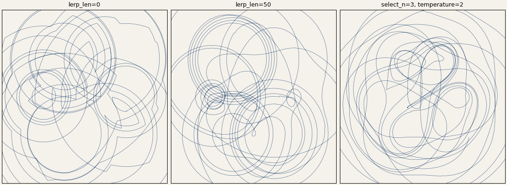

## Color fields

### 12 — MatrixColorField

[`12-matrix_color_field.py`](12-matrix_color_field.py)

Gives a color for each point. It reduces the image to `n_colors` colors with k-means, and then draws one of them according to how common each color is in a window around the point. The window size is `kernel_size`. A low `temperature` favors the most common color in the window, and a high one approaches a random color from the whole palette, as in the third panel.

Each point in this figure is one call to the field.

Unlike `MatrixField`, this field has `y=0` at the **top** of the image, so the demos flip y to draw.

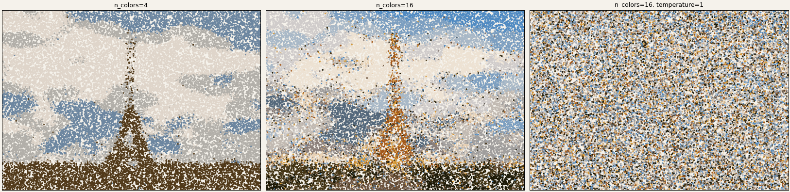

## Vector utilities

Functions from `tstudio.utils` that modify a vector. The demos apply them to each step of a line.

### 13 — rotate_vector

[`13-rotate_vector.py`](13-rotate_vector.py)

Rotates a vector by an angle in radians. Applied to every step of a rotation field, it turns circles into spirals, and at 90 degrees into rays.

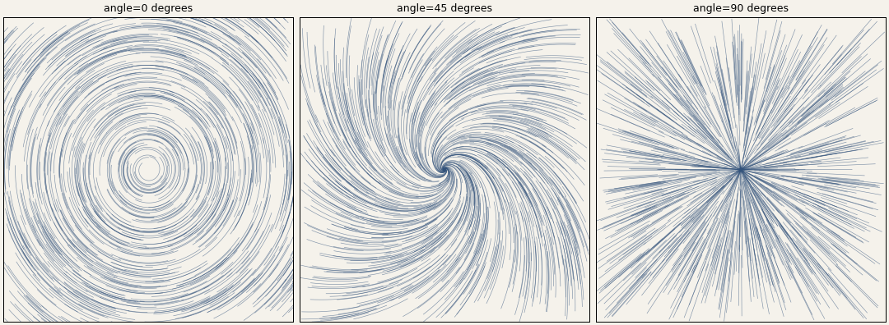

### 14 — quantize_vector

[`14-quantize_vector.py`](14-quantize_vector.py)

Keeps the length of a vector and rounds its angle to one of `n_levels` directions, so circles become polygons.

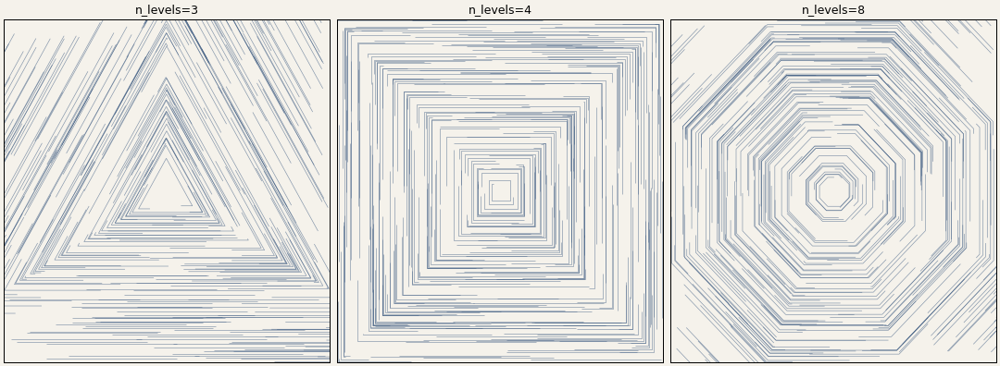

### 15 — clamp_vector

[`15-clamp_vector.py`](15-clamp_vector.py)

Limits the length of a vector to between `min_length` and `max_length`. Each line in this figure is a single step of a field whose vectors grow with the distance from the center.

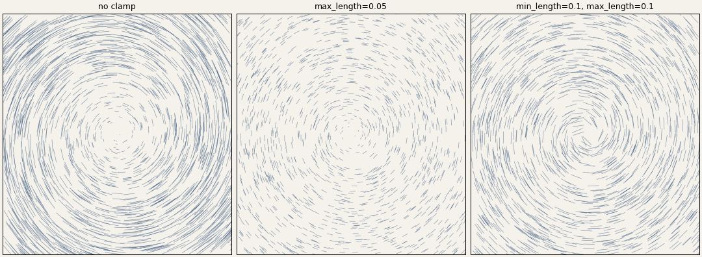

## Everything together

### 16 — A tree of fields

[`16-field_tree.py`](16-field_tree.py)

A `FieldSum` that contains another `FieldSum` (a spiral), a `FieldMax` and a `NoiseField`. A `MatrixField` makes the spiral stronger where the image is bright, and a `MatrixColorField` colors each line.

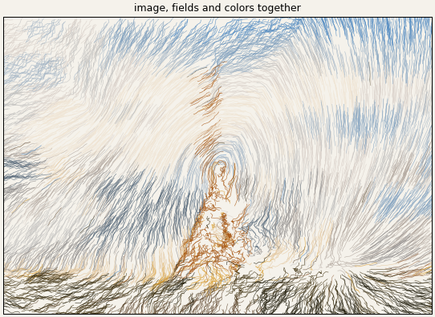

## What has no demo

- `ScalarField`, `FlowField` and `ColorField` are abstract base classes.
- `normalize_vector`, `clamp`, `lerp`, `cartesian_to_polar` and `polar_to_cartesian` in `tstudio.utils` are small math helpers. `normalize_vector` is what `normalize=True` applies.
